Ну вот и докатились до того, что будущий DevOps (я очень надюсь) пишет тетрис.\
Прекрасно понимаю людей которые не очень любят читать большое количество чужого кода. Я и свой то через некоторое время читаю с трудом.\
Поентому, происходящее, свои решения, обоснования выбранных вариантов опишу туть.

## 1. Общие положения

Несмотря на то, что задание называется "BrickGame Тетрис", оно не совсем про тетрис. Ну, или точнее тетрис тут побочная производная.\
В данном задании больший упор дается на ряд условий, ограничивающих (хоть и не сильно) разброд фантазии погроммиста.

Нам рассказывают про консольные игры, конечные автоматы. Но часть важной информации скрывает в отдельном маленьком файле, который можно легко пропустить, но в котором описаны требования/спецификация к проекту. Именно там мы узнаем, что, по сути, енто наш превый проект, где встречается API. И, по стуи, нам надо написать две программы. Одна из них - терминал игры с графическим интерфейсом и методами управления, а вторая - собственно игра.

Как нам сообщают, будут еще игры, и другие интерфейсы, но все библиотеки, по сути, должны иметь возможность меж собой соединяться, т.е. иметь общий интерфейс.\
Для ентого нам дают структуру, известное перечисление возможных действий и две функции, одна передает из терминала игре какое действие мы хотим совершить, а вторая запрашивает от игры актуальную картинку поля. И енти структуры и функции мы не имеем права менять.

Но, на ентом и заканчиваются, по большей части, все ограничения.\
По сути, дальше твори, что хочешь. Ну, и по традиции, должен отметить, что я прям натворил.

### 1.1 Выбор концепции

По идее, приложение терминала можно было уложить бы и что-то около полутора сотен строк, а не в семь сотен. Но обо всем по порядку.

Для начала подумаем, как можно было бы решить задачу, формально вписываясь в ТЗ.

1. Не заморачиваться с библиотеками.\
Вариант хороший, можно написать модуль, который формально принимает функцию действия и не менее формально отдает поле.\
Компилируем модули в .o, потом компонуем в один исполняемый файл.
2. Статическая библиотека.\
Уже проходили такие библиотеки. Дорога известная.\
Компилируем, архивируем в .а, прикладываем файл заголовков и отдаем отделу, который пишет гуй.\
Потом компонуем вместе с гуем в один исполняемый файл. Но вот если нам понадобится добавить еще одну игру, то компонуем все заново.
3. Динамическая библиотека.\
Таким мы еще не занимались, но метода выглядит более многообещающе. Так как если мы захотим что-то поменять в нашей игре, то не придется заново компоновать все, а только пересобрать саму игру.

Хочу отметить вот что, все енти варианты правильные. Если мы формально не нарушаем механику общения гуй-апи, то все зависит от предпочтений погроммиста.\
Однако, мы пойдем третьей путёй. Обоснование? Да по приколу. Я вообще много где в ентом проекте себе жизнь для прикола усложнил.


Усложнение первое. Динамическую библиотеку можно по-человечески прилинковать при компоновке исполняемого файла. Но при таком раскладе мы получим полужесткую сцепку. Да, если нам надо что-то подкрутить в игре, мы пересобираем библиотеку. Но как подключить другие игры в нашему универсальному терминалу?\
В теории можно, но добавление будет означать и перелинковку.

А можно создать известный каталог и при запуске терминала просто проверять его на наличие игр, и подключать библиотеки уже по ходу работы терминала.\
Такой способ мне кажется более интересным, так как игры, по сути своей становятся просто плагинами.

Второй вопрос, который тут может возникнуть (часть 2 задания) кто будет записывать рекорд игры?\
В ТЗ нет четкого условия, поентому порассуждаем. Если бы мы исходили из логики один гуй-одна игра, то логично было бы самой игре и предоставить такую функцию.\
Но, поскольку у нас гуй стремится к многофункциональному терминалу, то можно на него и повесить запись рекордов, так как в один файл можно будет записывать рекорды разных игр.

Однако, если вдруг изменится ТЗ, то перенести енту функцию в игру не будет составлять труда. Из самой игры даже проще записывать.

## 2. Терминал/Графический интерфейс

И поскольку мы усложняем гуй/терминал, то конечных автоматов/логических блоксхем у нас будет 2. Вот первая блок-схема:

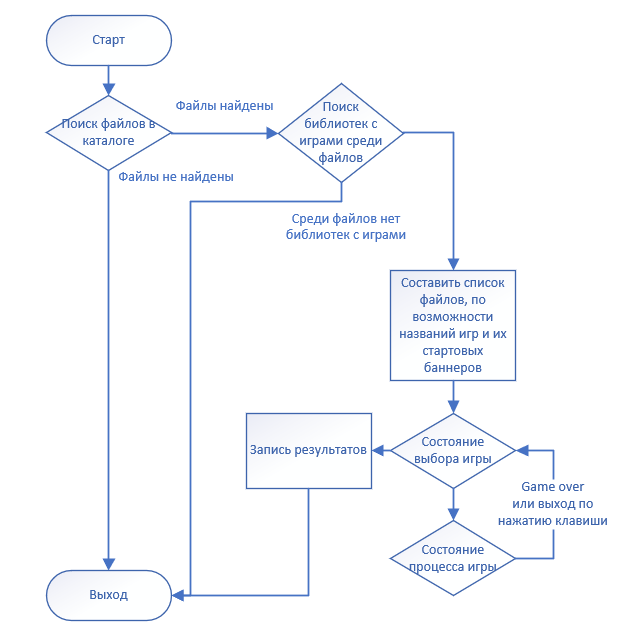

Теперь по порядку:

### 2.1 Поиск файлов в каталоге

Для учета файлов введем структуру учета:
```c
typedef struct GameStartInfo_t {
  char game_name[256];
  char file_name[256];
  int start_screen[20][10];
} GameStartInfo_t;
```
Тут у нас есть имя игры, имя файла (они могут быть разными) и стартовый баннер.

И заведем структуру учета структур учета, в которой просто будем вести учет числа записей.
```c
typedef struct {
  struct GameStartInfo_t *game_start_info;
  int file_count;
} GameFiles_t;
```

Но откуда мы возьмем название игры и баннер?\
А мы введем еще одну доступную из вне функцию в библиотеке которая будет нам возвращать структуру GameStartInfo_t. ТЗ енто не запрещает. ТЗ запрещает нам менять те, которые указаны в спецификации. И запрещает нам их не использовать.

Дополнительная же функция будет необязательной, и ее отсутствие ни на что не повлияет.

Итак, нами был определен каталог (придумано название) GAME_FILES_DIR в котором и будем хранить/искать весь хлам. Теперь пора собирать список файлов:
```c
int main() {
    GameFiles_t game_files_list;
    //Вот енту функцию разберем чуть ниже
    make_game_file_list(&game_files_list);
    if ((game_files_list.file_count != -1) &&
        (game_files_list.file_count != 0)) {
            //Тут пока не важно
    } else {
      if (game_files_list.file_count == -1) {
        printf("There is no directory %s, or can`t access.\n", GAME_FILES_DIR);
      } else {
        printf("There are no game libraries in directory %s.\n",
               GAME_FILES_DIR);
      }
    }
    //Функция освобождения массива со GameStartInfo_t
    free_game_file_list(game_files_list);
  return SUCCESS;
}
```
```c
void make_game_file_list(GameFiles_t *game_files_list) {
  game_files_list->game_start_info = (struct GameStartInfo_t *)malloc(sizeof(struct GameStartInfo_t) * 0);
  int res = 0;
  //Пробуем открыть каталог
  DIR *dr = opendir(GAME_FILES_DIR);
  //Если по какой-то причине не можем ентого сделать, то и продолжать нет слысла
  if (dr != NULL) { 
    //Используем библиотеку dirent чтоб получить информацию о файлах в каталоге
    struct dirent *find_files;
    while ((find_files = readdir(dr)) != NULL) {
      //Если очередной файл является... ээээ... ну, файлом, то берем его на проверку
      if ((find_files->d_type == DT_REG) &&
          (strcmp(find_files->d_name, HISCORE_FILE_NAME) != 0)) {
        GameStartInfo_t cur_file;
        //Собственно, проверяем, не библиотка ли с игрой он часом
        if (load_library(GAME_FILES_DIR, find_files->d_name, true, &cur_file) == 0) {
          //Если да, то записываем его в наш список
          res++;
          game_files_list->game_start_info = (struct GameStartInfo_t *)realloc(
              game_files_list->game_start_info, sizeof(struct GameStartInfo_t) * (res));
          game_files_list->game_start_info[res - 1] = cur_file;
        }
      }
    }
    closedir(dr);
  } else {
    res = -1;
  }
  game_files_list->file_count = res;
}
```

Теперь о проверке на ~~вшиво~~ библиотеку с игрой.\
Первое, что мы узнаем, как только нам говорят, что библиотеки можно подключать по ходу полета - то, что функции, по своей сути, тоже являются указателями.\
Поентому мы пропишем стуктуру по которой и будем линковать нашу библиотеку:

```c
typedef struct {
  void *lib;
  GameInfo_t (*updateCurrentState)();
  void (*userInput)(UserAction_t action, bool hold);
  GameStartInfo_t (*getGameStartInfo)(void);
} LibrarySet_t;
```
Нас интересуют ссылка на сам файл, и адреса трех функций.
```c
//Енту функцию мы будем вызывать в двух случаях: для проверки файла, и для самой игры
//Поетому мы делаем указание bool check
int load_library(char *file_path, char *file_name, bool check, GameStartInfo_t *file_info) {
  int res = 0;
  char filename[PATH_MAX + FILENAME_MAX];
  snprintf(filename, sizeof(filename), "%s%s", file_path, file_name);
  //Получаем адрес на LibrarySet_t
  LibrarySet_t *lib = lib_set();
  //Открываем, как мы полагаем, библиотеку
  lib->lib = dlopen(filename, RTLD_LAZY);
  
  //Если не открылось - значит не библиотека
  if (!lib->lib) {
    res = 1;
  } else {
    //Иначе линкуем наши объявленные заглушки функций
    *(void **)(&(lib->updateCurrentState)) = dlsym(lib->lib, "updateCurrentState");
    if (dlerror() != NULL) {
      dlclose(lib->lib);
      res = 2;
    }
    if (res == 0) {
      *(void **)(&(lib->userInput)) = dlsym(lib->lib, "userInput");
      if (dlerror() != NULL) {
        dlclose(lib->lib);
        res = 2;
      }
    }
    //Если двух объязательных функций не найдено, значит, хоть енто и библиотека, но не с игрой
    if ((res == 0) && (check)) {
      //А вот если енто все же игра, то пробуем получить стартовую информацию
      *(void **)(&(lib->getGameStartInfo)) = dlsym(lib->lib, "getGameStartInfo");
      if (dlerror() != NULL) {
        //Однако, если не получилось, то не расстраиваемся, а просто заполняем все ручками:
        strcpy(file_info->file_name, file_name);
        //Название файла станет и названием игры
        strcpy(file_info->game_name, file_name);
        //А приветственный баннер будет нулевым
        for (int i = 0; i < 20; i++) {
          for (int j = 0; j < 10; j++) {
            file_info->start_screen[i][j] = 0;
          }
        }
      } else {
        *file_info = lib->getGameStartInfo();
        strcpy(file_info->file_name, file_name);
      }
      //И вот важное - если мы лишь собираем первоначальную информацию, то библиотеку надо закрыть
      dlclose(lib->lib);
    }
  }

  return res;
}
```

Воооот... А казалось, что будет сложнее.

### 2.2 Запись рекордов

Раз уж мы решили передать енту функцию терминалу, то надо понимать, что игр может быть много. И для етного нам понадобится еще одна структура:
```c
typedef struct HiScoreRecord_t {
  char game_name[256];
  int score;
} HiScoreRecord_t;
```
И структура учета структур:
```c
typedef struct {
  struct HiScoreRecord_t *records;
  int record_count;
} HiScoreList_t;
```

Дополним наш main:
```c
int main() {
    GameFiles_t game_files_list;
    make_game_file_list(&game_files_list);
    if ((game_files_list.file_count != -1) &&(game_files_list.file_count != 0)) {
      //Создаем список рекордов
      HiScoreList_t hiscore_list;
      //Пытаемся прочитать файл с рекордами, но если не выйдет, то не страшно
      read_hiscore_list(&hiscore_list);

        //Тут все еще не важно, но походу игры мы будем обновлять рекорды
        update_current_hiscore(&hiscore_list, game_name, score);

      //Записываем рекорды
      write_hiscore_list(hiscore_list);
      //Освобождаем память
      free_hiscore_list(&hiscore_list);
    } else {
      if (game_files_list.file_count == -1) {
        printf("There is no directory %s, or can`t access.\n", GAME_FILES_DIR);
      } else {
        printf("There are no game libraries in directory %s.\n",
               GAME_FILES_DIR);
      }
    }
    free_game_file_list(game_files_list);
  return SUCCESS;
}
```
Начнем с конца. Запись рекордов:
```c
bool write_hiscore_list(HiScoreList_t *hiscore_list) {
  //Если список пуст, то и делать нечего
  if (hiscore_list->record_count < 1) {
    return false;
  }

  bool res = false;
  char filename[PATH_MAX + (FILENAME_MAX * 2)];
  snprintf(filename, sizeof(filename), "%s%s", proc_path(), HISCORE_FILE_NAME);
  //Делаем попытку открыть известный нам, да и нами же определенный HISCORE_FILE_NAME
  FILE *ptrFile = fopen(filename, "wb");
  
  //Если не получилось, то соболезнуем
  if (ptrFile != NULL) {
    //Если же получилось, то запишем сперва количество записей (да, можно было читать по длине структуры, но я сделал так)
    if (fwrite(&(hiscore_list->record_count), sizeof(int), 1, ptrFile) == 1) {
      res = true;
      //А потом и все имеющиеся рекорды последовательно
      for (int i = 0; i < hiscore_list->record_count && res; i++) {
        res = (fwrite(&(hiscore_list->records[i]), sizeof(struct HiScoreRecord_t), 1, ptrFile) == 1);
      }
    }
    fclose(ptrFile);
    if (res == false) {
      FILE *ptrFile = fopen(filename, "wb");
      fclose(ptrFile);
    }
  }
  return res;
}
```

Фукция чтения:
```c
bool read_hiscore_list(HiScoreList_t *hiscore_list) {
  bool res = false;
  hiscore_list->record_count = 0;
  //Выделим 0 места, чтоб дальше использовать realloc
  hiscore_list->records = (struct HiScoreRecord_t *)malloc(sizeof(struct HiScoreRecord_t) * 0);

  char filename[PATH_MAX + (FILENAME_MAX * 2)];
  snprintf(filename, sizeof(filename), "%s%s", proc_path(), HISCORE_FILE_NAME);
  //Открываем файл на чтение
  FILE *ptrFile = fopen(filename, "rb");
  //Если не открылся, чтож. Хотя бы у нас готовая к наполнению определенная нулевая структура
  if (ptrFile != NULL) {
    if (fread(&(hiscore_list->record_count), sizeof(int), 1, ptrFile) == 1) {
      res = true;
      //Если нам удалось прочитать число предполагаемых записей то сразу готовим список
      hiscore_list->records = (struct HiScoreRecord_t *)realloc(hiscore_list->records,
          sizeof(struct HiScoreRecord_t) * hiscore_list->record_count);
      size_t status = 1;
      for (int i = 0; i < hiscore_list->record_count && status == 1; i++) {
        status = fread(&(hiscore_list->records[i]), sizeof(struct HiScoreRecord_t), 1, ptrFile);
      }
      //Если что-то не прочиталось, то считаем файл испорченным, а информацию полностью неправильной
      if (status != 1) {
        free(hiscore_list->records);
        hiscore_list->records = (struct HiScoreRecord_t *)malloc(sizeof(struct HiScoreRecord_t) * 0);
        hiscore_list->record_count = 0;
        res = false;
      }
    }
    fclose(ptrFile);
  }
  return res;
}
```

Ну и функция обновления самих рекордов:
```c
bool update_current_hiscore(HiScoreList_t *hiscore_list, char *g_name, int g_score) {
  bool res = false;
  //Если в нашем списке мы нашли запись о нашей игре и новый счет больше записанного, то обновляем
  for (int i = 0, status = 1; i < hiscore_list->record_count && status; i++) {
    if (strcmp(hiscore_list->records[i].game_name, g_name) == 0) {
      if (hiscore_list->records[i].score <= g_score) hiscore_list->records[i].score = g_score;
      status = 0;
      res = true;
    }
  }
  if (!res) {
    //Если запись об игре еще не сделана, то добавим в список
    hiscore_list->record_count = hiscore_list->record_count + 1;
    hiscore_list->records = (struct HiScoreRecord_t *)realloc(hiscore_list->records,
        sizeof(struct HiScoreRecord_t) * hiscore_list->record_count);
    snprintf( hiscore_list->records[hiscore_list->record_count - 1].game_name,
        sizeof(hiscore_list->records[hiscore_list->record_count - 1].game_name), "%s", g_name);
    hiscore_list->records[hiscore_list->record_count - 1].score = g_score;
    res = true;
  }
  return res;
}
```

Вы, вероятно, могли заметить, что я говорил о GAME_FILES_DIR и HISCORE_FILE_NAME, но при использовании функций работающих с файлами я путь привожу к странной контструкции filename.\
Но вот в чем дело. Контекст. Всегда есть контекст.\
Как вы думаете, что будет, при определенных GAME_FILES_DIR="./gamefiles/" и HISCORE_FILE_NAME="hiscore" если я запущу игру "./game"?\
Правильно. Все будет хорошо.\
А если "./directory/game"?\
Как говорится "не было печали, апдейтов накачали".

Для начала зададим функции main аргументов
```c
int main(int argc, char **argv) {
```

И сделаем функцию, которая будет при помощи нулевого аргумента собирать действительный путь до нашей игры "process_path".
Который, в свою очередь, чтоб не использовать глобальных переменных, и не задолбаться передавать его по функциям, сделаем статической локальной переменной:
```c
char *proc_path(void){
  static char process_path[PATH_MAX + FILENAME_MAX] = "";
  return process_path;
}

int get_procpath_size(void){
  return PATH_MAX + FILENAME_MAX;
}
```
Ну и сама функция сборки пути:
```c
bool get_gamefiles_path(char *argv_0) {
  bool res = false;
  //Если начинается не со '/', т.е. либо запуск по имени, либо по относительному пути,
  if (argv_0[0] != '/') {
    //то попросим прислать путь до места, откуда запустили файл,
    if (getcwd(proc_path(), get_procpath_size()) != NULL) {
      //приишем "/" и собственно нулевой аргумент
      strcat(proc_path(), "/");
      strcat(proc_path(), argv_0);
      res = true;
    }
  } else {
    //Если же у нас прямой путь, то с ним и работаем
    strcpy(proc_path(), argv_0);
    res = true;
  }
  if (res) {
    //Но енто путь прям до файла программы
    //Прошерстим от конца строки до первого '/' и поставим за ним терминирующий нуль
    int len = strlen(proc_path());
    for (int i = len - 1, check = 1; (i >= 0) && (check); i--) {
      if (proc_path()[i] == '/') {
        proc_path()[i + 1] = '\0';
        check = 0;
      }
    }
    //И тут уже допишем наше название каталога со всякой всячиной
    strcat(proc_path(), GAME_FILES_DIR);
  }
  return res;
}
```

### 2.3 Управление игрой

Давайте сверимся с нашей картой и увидим, что нам осталось сделать лишь малую часть отмеченную прямоугольником:
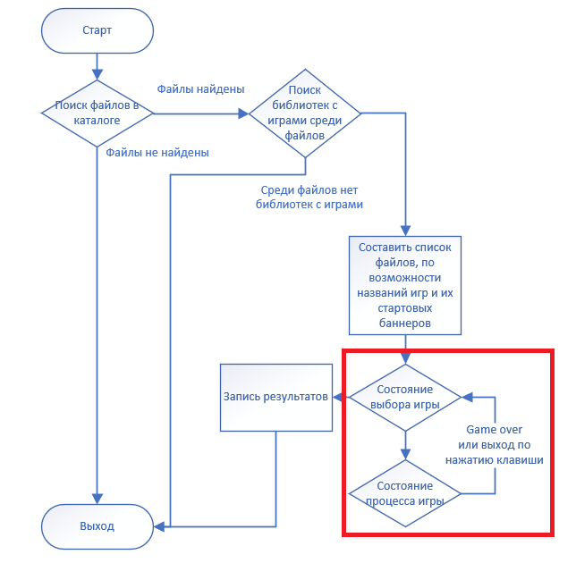

Создадим структуру/перечень для определения состояния игры:
```c
typedef enum {
  Selecting,
  Started,
  Exit,
  Paused,
  GameOver,
  HiScoreWriteErr
} GameStatus_t;
```

Тут все самое основное, но я еще добавил состояние, которое будет сигнализировать о том, что файл рекордов записать не удалось.

Ну и обработчик цикла нашего терминала:
```c
//Пляшем, пока пользователь не пожелает закрыть всё
while (get_game_status() != Exit) {
    //Даем игроку возможность нажать на кнопку
    switch (getch()) {
      //При нажатии на кнопку запускается соответствующая функция
      case ENTER_KEY:
        action_start_button(game_files_list->game_start_info[selected_game].file_name);
        break;
      case 'p':
      case 'P':
        action_pause_button(game_files_list, selected_game);
        break;
      case 'q':
      case 'Q':
        action_quit_button(&hiscore_list, game_files_list, selected_game);
        break;
      case KEY_LEFT:
        action_left_button(&selected_game);
        break;
      case KEY_RIGHT:
        action_right_button(&selected_game, game_files_list->file_count);
        break;
      case KEY_UP:
        action_up_button();
        break;
      case KEY_DOWN:
        action_down_button();
        break;
      case ' ':
        action_action_button();
        break;
    }
    //Далее действия делаем только если у нас игра не показывает спец. окна (о них позже)
    if ((get_game_status() != GameOver) && (get_game_status() != Paused) && (get_game_status() != HiScoreWriteErr)) {
      //Если идет игра
      if (get_game_status() == Started) {
        //Запрашиваем у игры текущее состояние
        GameInfo_t curr_state = lib->updateCurrentState();
        //Об ентом объяснение будет ниже, но по сути так отлавливаем конец игры
        if (curr_state.level == -1) {
          //Передаем игре, что всё, мы наигрались, надо все подчистить, библиотеку будем отключать
          lib->userInput(Terminate, true);
          //Указываем статус
          set_game_status(GameOver);
        } else {
          //Если продолжаем играть, то чекаем рекорды
          update_current_hiscore(&hiscore_list, game_files_list->game_start_info[selected_game].game_name,
              curr_state.score);
        }
      }
      if (get_game_status() == Selecting)
        //Если же мы еще только выбираем, во что поиграть, то рисуем приветственный баннер
    }
  }
```

Теперь к вопросу о геймовере.\
Вот наша неизмеяемая стркутура:
```c
typedef struct {
  int **field;
  int **next;
  int score;
  int high_score;
  int level;
  int speed;
  int pause;
} GameInfo_t;
```

Надо какой-то образой передать гую, что дальше играть никак не можно. Опять же, жестких условий на енто нет.\
Я вижу два простых решения данной задачки:
1. Передать next по нулям.
2. Обозначить невозможное значение чему-то другому.

Как мне кажется, проще и надежнее уровень отрицательным передать.\
Однако такое решение подходит под текущее ТЗ. Я не знаю, что будет в других играх, так что учитывать все возможности сложно.

Дальше пробежимся по функциям от клавиш:
1. Жмяк по энтеру - выбрали и стартанули игру:
```c
void action_start_button(char *file_name) {
  //Имеет смысл жать только когда выбираем игру
  if (get_game_status() == Selecting) {
    //Грузим библиотеку, причем check = false, 
    //т.е. GameStartInfo_t (*getGameStartInfo)(void) не присваивается и библиотека не закрывается
    if (load_library(proc_path(), file_name, false, NULL) == 0) {
      LibrarySet_t *lib = lib_set();
      //Отправляем игре сообщение, что мы её выбрали, так что пусть просыпается
      lib->userInput(Start, true);
      //Устанавливаем статус
      set_game_status(Started);
    }
  }
}
```
2. Кнопка паузы:
```c
void action_pause_button(GameFiles_t *game_files_list, int selected_game) {
  //Если игра в разгаре
  if (get_game_status() == Started) {
    LibrarySet_t *lib = lib_set();
    //Меняем статус на паузу, и отправляем игре, что мы тут на паузу нажали
    lib->userInput(Pause, true);
    set_game_status(Paused);
  }
}
```
3. Последняя дополнительная кнопка, но крайне важная - выход:
```c
void action_quit_button(HiScoreList_t *hiscore_list, GameFiles_t *game_files_list, int selected_game) {
  if (get_game_status() == Started) {
    LibrarySet_t *lib = lib_set();
    //Если идет игра, то передаем игре Terminate, закрываем библиотеку, и меняем стату на Selecting
    lib->userInput(Terminate, true);
    dlclose(lib->lib);
    set_game_status(Selecting);
  } else if (get_game_status() == Selecting) {
    //Но если мы и так на стадии выбора игры, то сначала пытаемся сохранить рекорды
    if (!write_hiscore_list(hiscore_list)) {
      //Если не получилось, то выведем сообщение об ентом
      set_game_status(HiScoreWriteErr);
    } else {
      //Если все ок, то можно выходить из ентого порочного круга
      set_game_status(Exit);
    }
  }
}
```
4. Кнопка действия (у нас енто пробел):
```c
void action_action_button() {
  //Если в игре, то пошлем ей сигнал, что мы хотим что-то сделать (в случае тетриса - повертеть фигуру)  
  if (get_game_status() == Started) {
    LibrarySet_t *lib = lib_set();
    lib->userInput(Action, true);
  }
  //Если у нас висит окно паузы
  if (get_game_status() == Paused) {
    //Переводим игру в рабочее состояние и отправляем ей еще одно сообщение о паузе
    set_game_status(Started);
    LibrarySet_t *lib = lib_set();
    lib->userInput(Pause, true);
  }
  //Если у нас висит окно ошибки записи файла рекордов то переводим в Exit
  if (get_game_status() == HiScoreWriteErr) {
    set_game_status(Exit);
  }
  //Ну а если висит окно паузы GameOver, то переводим опять к выбору игры
  if (get_game_status() == GameOver) {
    set_game_status(Selecting);
  }
}
```
5. Кнопки вверх и вниз просто отправляют игре сообщение о данных событиях
```c
void action_up_button() {
  if (get_game_status() == Started) {
    LibrarySet_t *lib = lib_set();
    lib->userInput(Up, true);
  }
}

void action_down_button() {
  if (get_game_status() == Started) {
    LibrarySet_t *lib = lib_set();
    lib->userInput(Down, true);
  }
}
```
6. А кнопки влево и вправо листают наши игры по списку в режиме выбора и пересылают игре информацию о действии:
```c
void action_left_button(int *selected_game) {
  if (get_game_status() == Selecting) {
    if (*selected_game > 0) {
      *selected_game = *selected_game - 1;
    }
  }
  if (get_game_status() == Started) {
    LibrarySet_t *lib = lib_set();
    lib->userInput(Left, true);
  }
}

void action_right_button(int *selected_game, int file_count) {
  if (get_game_status() == Selecting) {
    if (*selected_game < file_count - 1) {
      *selected_game = *selected_game + 1;
    }
  }
  if (get_game_status() == Started) {
    LibrarySet_t *lib = lib_set();
    lib->userInput(Right, true);
  }
}
```

А и все. С управлением управились.

### 2.4 Графический интерфейс

Поскольку у нас два состояния игры, то стоит учесть и несколько состояний графического интерфейса.\
Начнем с самой игры:

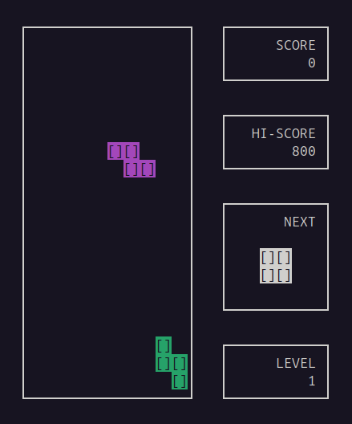

У нас есть все основные поля, как то и требуется по ТЗ.\
И да, можно придумать другой интерфейс для выбора игры. Но лучше просто переиначить то, что уже есть:

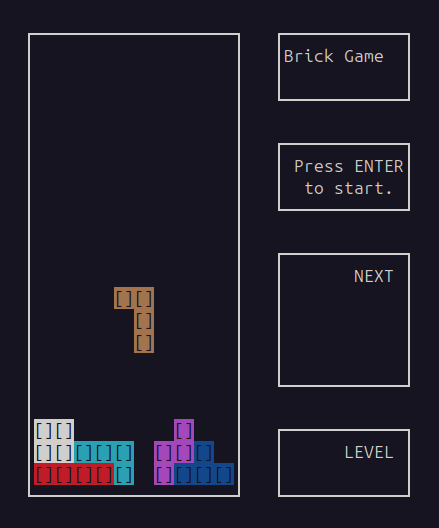

Как видно, NEXT и LEVEL пусты, вместо счета у нас название игры (сколько влезет), а вместо рекорда мигает приглашение нажать энтер.

Кстати, в ТЗ написано так: "Игровое поле представляется, как матрица размерностью десять на двадцать. Каждый элемент матрицы соответствует «пикселю» игрового поля и может находиться в одном из двух состояний: пустой и заполненный."

В теории, енто может означать, что там может быть либо 0, либо 1. Однако, можно указать число выше 0, и тогда, можно использовать цвета.\
Но, если у нас терминал нашего линуха не поддерживает цвета, мы енто тоже учтем и сделаем прорисовку и нецветную:

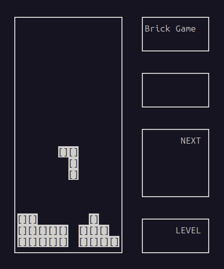

и

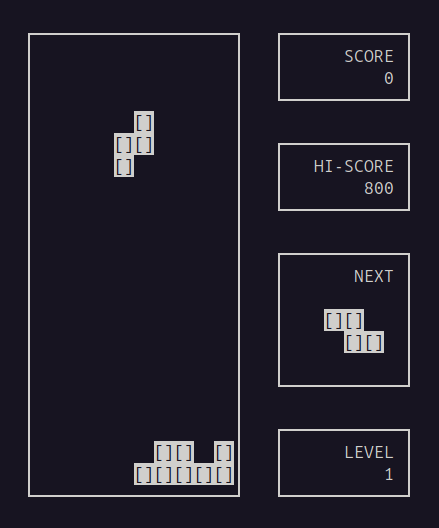

Ну и собственно переходим к нашим новым проклятиям:
```c
int main(int argc, char **argv) {
  if ((argc > 0) && (get_gamefiles_path(argv[0]))) {
    GameFiles_t game_files_list;
    make_game_file_list(&game_files_list);
    if ((game_files_list.file_count != -1) &&
        (game_files_list.file_count != 0)) {
      //Пачка стандартных объявлений
      initscr();            
      noecho();             
      curs_set(0);          
      keypad(stdscr, TRUE); 
      timeout(50); 
      //Функция определения цвета
      init_colours();
      //Функция управления игрой
      select_and_game(&game_files_list);
      //Завершение работы с ncurses
      endwin();
    } else {
      if (game_files_list.file_count == -1) {
        printf("There is no directory %s, or can`t access.\n", GAME_FILES_DIR);
      } else {
        printf("There are no game libraries in directory %s.\n",
               GAME_FILES_DIR);
      }
    }
    free_game_file_list(game_files_list);
  } else {
    printf("Can`t find game file.\n");
  }
  return SUCCESS;
}
```

Функция определения цвета тоже будет ссылаться на статическую локальную переменную:
```c
bool* is_colour(void){
  static bool is_colour = false;
  return &is_colour;
}

void set_is_colour(bool state){
  bool *is_cl = is_colour();
  *is_cl = state;
}

bool get_is_colour(void){
  return *(is_colour());
}
```

Она нам много где понадобится.\
Ну и само определение:
```c
void init_colours(void) {
  if (has_colors()) {
    //Если терминал поддерживает цвета, то определяем переменную
    set_is_colour(true);
    //Стартуем в ncurses цвета
    start_color();
    //И определяем палитру
    init_pair(1, COLOR_RED, COLOR_BLACK);
    init_pair(2, COLOR_GREEN, COLOR_BLACK);
    init_pair(3, COLOR_YELLOW, COLOR_BLACK);
    init_pair(4, COLOR_BLUE, COLOR_BLACK);
    init_pair(5, COLOR_MAGENTA, COLOR_BLACK);
    init_pair(6, COLOR_CYAN, COLOR_BLACK);
    init_pair(7, COLOR_WHITE, COLOR_BLACK);
    init_pair(8, COLOR_BLACK, COLOR_WHITE);
  } else {
    set_is_colour(false);
  }
}
```

Теперь на нужны окошки, которые мы видели выше:
1. Область игрового поля:
```c
void prepare_game_grid(int game_field[ROWS_MAP][COLS_MAP]) {
  //Зададим окно с параметрами
  WINDOW *game_grid = newwin(GAME_GRID_ROWS, GAME_GRID_COLS, MIN_ROWS_COLS, MIN_ROWS_COLS * 2);
  //Обводим его рамочкой
  box(game_grid, 0, 0);
  //И просто рисуем каждый наш "пиксель". Он занимает одну строку и два символа. 
  //Выглядит "[]", но можно было просто пробелы поставить
  for (int i = 0; i < ROWS_MAP; i++) {
    for (int j = 0; j < COLS_MAP; j++) {
      if ((game_field[i][j] != 0) && (get_is_colour())) {
        //Если работаем в цвете, то нормализуем значение, а то вдруг какой шутник в библиотеки с игрой вышел за палитру
        int colour = game_field[i][j];
        if (colour < 0) colour = 7;
        if (colour > 7) colour = 7;
        //COLOR_PAIR(colour) указывает, что нам надо цветное
        mvwhline(game_grid, i + 1, (j * 2) + 1, '[' | A_STANDOUT | COLOR_PAIR(colour), 1);
        mvwhline(game_grid, i + 1, (j * 2) + 2, ']' | A_STANDOUT | COLOR_PAIR(colour), 1);
      }
      if ((game_field[i][j] != 0) && (!get_is_colour())) {
        //А если не надо цветное, то так просто пишем
        mvwhline(game_grid, i + 1, (j * 2) + 1, '[' | A_STANDOUT, 1);
        mvwhline(game_grid, i + 1, (j * 2) + 2, ']' | A_STANDOUT, 1);
      }
    }
  }
  //Вываливаем на экран
  wrefresh(game_grid);
  //Вот тут признаю, что не совсем разобрался в ncurses. 
  //По идее, окно - локальная переменная, и ее удалят после завершения функции.
  //Но у ncurses есть функция удаления окон, так что пусть тут будет. Мож меньше утечек памяти будет. 
  delwin(game_grid);
}
```
2. Область счета:
```c
void prepare_score_grid(int score, char *gamename) {
  WINDOW *score_grid = newwin(SCORE_GRID_ROWS, ADD_GRID_COLS, SCORE_GRID_START_ROW, SCORE_GRID_START_COL);
  box(score_grid, 0, 0);
  //Если вы выбираем игру, то пусть тут пишет её название
  if (get_game_status() == Selecting) {
    mvwprintw(score_grid, 1, 1, "%s", gamename);
  } else {
    //Ну, а если мы играем, то в первой строке "SCORE"
    //а во второй 10 порядков счета. Заметьте, максимальный счет я ограничил.
    //Да, ограничил довольно произвольным образом, но он вписывается и в окно и в int со знаком
    mvwprintw(score_grid, 1, 7, "SCORE");
    if (score > 1999999999) {
      score = 1999999999;
    }
    mvwprintw(score_grid, 2, 2, "%10d", score);
  }
  wrefresh(score_grid);
}
```
3. Область рекорда:
```c
void prepare_hiscore_grid(int hiscore) {
  WINDOW *hiscore_grid = newwin(HISCORE_GRID_ROWS, ADD_GRID_COLS, HISCORE_GRID_START_ROW, HISCORE_GRID_START_COL);
  box(hiscore_grid, 0, 0);
  if (get_game_status() == Selecting) {
    //По сути, то же самое, но wattron A_BLINK задает мигание надписи. Так прикольненко))
    wattron(hiscore_grid, A_BLINK);
    mvwprintw(hiscore_grid, 1, 2, "Press ENTER");
    mvwprintw(hiscore_grid, 2, 3, "to start.");
    wattroff(hiscore_grid, A_BLINK);
  } else {
    mvwprintw(hiscore_grid, 1, 4, "HI-SCORE");
    if (hiscore > 1999999999) {
      hiscore = 1999999999;
    }
    mvwprintw(hiscore_grid, 2, 2, "%10d", hiscore);
  }
  wrefresh(hiscore_grid);
}
```
4. Область показа следующей фигуры:
```c
void prepare_next_grid(int next_field[4][4]) {
  WINDOW *next_grid = newwin(NEXT_GRID_ROWS, ADD_GRID_COLS, NEXT_GRID_START_ROW, NEXT_GRID_START_COL);
  box(next_grid, 0, 0);
  mvwprintw(next_grid, 1, 8, "NEXT");
  //Фигуры вообще - квадрат 4*4 и отрисовывем примерно как окно игрового поля. 
  //Останавливаться не на чем
  for (int i = 0; i < 4; i++) {
    for (int j = 0; j < 4; j++) {
      if ((next_field[i][j] != 0) && (get_is_colour())) {
        int colour = next_field[i][j];
        if (colour < 0) colour = 7;
        if (colour > 7) colour = 7;
        mvwhline(next_grid, i + 2, (j * 2) + 3, '[' | A_STANDOUT | COLOR_PAIR(colour), 1);
        mvwhline(next_grid, i + 2, (j * 2) + 4, ']' | A_STANDOUT | COLOR_PAIR(colour), 1);
      }
      if ((next_field[i][j] != 0) && (!get_is_colour())) {
        mvwhline(next_grid, i + 2, (j * 2) + 3, '[' | A_STANDOUT, 1);
        mvwhline(next_grid, i + 2, (j * 2) + 4, ']' | A_STANDOUT, 1);
      }
    }
  }
  wrefresh(next_grid);
}
```
5. Область уровня даже приводить тут не буду.

А вот что стоит добавить - отрисовку окна паузы/гейм овера/ошибки записи файла рекордов:
```c
void prepare_info_grid(void) {
  //Посередь всего рисуем прямоугольник в рамочке с соответствующей надписью
  WINDOW *info_grid = newwin(INFO_GRID_ROWS, INFO_GRID_COLS, INFO_GRID_START_ROW, INFO_GRID_START_COL);
  box(info_grid, 0, 0);
  if (get_game_status() == Paused) {
    mvwprintw(info_grid, 2, (INFO_GRID_COLS / 2) - 2, "PAUSE");
  }
  if (get_game_status() == GameOver) {
    mvwprintw(info_grid, 2, (INFO_GRID_COLS / 2) - 5, "GAME OVER");
  }
  if (get_game_status() == HiScoreWriteErr) {
    mvwprintw(info_grid, 2, (INFO_GRID_COLS / 2) - 10, "CAN`T WRITE HI-SCORE");
  }
  //И мигалкой, что ожидается пробел, чтоб енто убрать
  wattron(info_grid, A_BLINK);
  mvwprintw(info_grid, 3, (INFO_GRID_COLS / 2) - 11, "Press SPACE to continue");
  wattroff(info_grid, A_BLINK);

  wrefresh(info_grid);
}
```

Ну и соберем функции отрисовки.\
При игре:
```c
void draw_curr_game_interface(GameInfo_t GameInfo, int hi_score) {
  //Отрисовываем все окна по порядку
  int game_field[ROWS_MAP][COLS_MAP];
  for (int x = 0; x < ROWS_MAP; x++) {
    for (int y = 0; y < COLS_MAP; y++) {
      game_field[x][y] = GameInfo.field[x][y];
    }
  }
  prepare_game_grid(game_field);
  prepare_score_grid(GameInfo.score, "");
  prepare_hiscore_grid(hi_score);
  int next_field[4][4];
  for (int x = 0; x < 4; x++) {
    for (int y = 0; y < 4; y++) {
      next_field[x][y] = GameInfo.next[x][y];
    }
  }
  prepare_next_grid(next_field);
  prepare_level_grid(GameInfo.level);
  //При надобности поверх всего лепим окна с предупреждением
  if ((int)get_game_status() >= 3) {
    prepare_info_grid();
  }
}
```
И отрисовка при выборе игры:
```c
void draw_select_game_interface(GameStartInfo_t game_start_info) {
  //Примерно то же самое. Можно было бы слить в одно, но может еще пригодится
  prepare_game_grid(game_start_info.start_screen);
  prepare_score_grid(0, game_start_info.game_name);
  prepare_hiscore_grid(0);
  int next_field[4][4] = {0};
  prepare_next_grid(next_field);
  prepare_level_grid(0);
  if ((int)get_game_status() >= 3) {
    prepare_info_grid();
  }
}
```

Теперь, когда мы умеем рисовать, ентим и займемся:
```c
bool select_and_game(GameFiles_t *game_files_list) {
  while (get_game_status() != Exit) {
    /*
    Тут было лишнее, или могла бы быть ваша реклама
    */
    if ((get_game_status() != GameOver) && (get_game_status() != Paused) &&
        (get_game_status() != HiScoreWriteErr)) {
      if (get_game_status() == Started) {
        GameInfo_t curr_state = lib->updateCurrentState();
        if (curr_state.level == -1) {
          lib->userInput(Terminate, true);
          set_game_status(GameOver);
          //Если игра закончилась, то рисуем приветственный экран и выводим плашку GameOver
          draw_select_game_interface( game_files_list->game_start_info[selected_game]);
        } else {
          update_current_hiscore(&hiscore_list, game_files_list->game_start_info[selected_game].game_name, curr_state.score);
          //Вот тут отрисовываем игру
          draw_curr_game_interface(curr_state, get_current_hiscore(&hiscore_list,
                  game_files_list->game_start_info[selected_game].game_name));
        }
      }
      if (get_game_status() == Selecting)
        //Ну или отрисовываем по правилам окна выбора игры
        draw_select_game_interface(game_files_list->game_start_info[selected_game], NO_INPUT);
    }
  }
  free_hiscore_list(&hiscore_list);
  return true;
}
```

Вот и весь рисовач.\
Но мне же не сидится спокойно. Можно же было на ентом успокоиться и нормально бы было. И модуль графического интерфейса был бы много короче.

В общем, следующее усложнение - я хочу отрисованные кнопки, и что б они нажимались вместе с нажатием на клавиатуре.

### 2.5 Расширение рафического интерфейса. Кнопки

Вот так хочу:

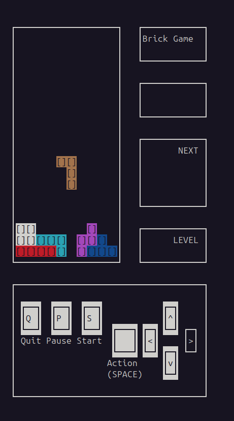

И вот простое "вот так хочу" выливается еще в три сотни строк. Не делайте так, не совершайте моих ошибок.

Как видите, кнопки разные по ширине/высоте и содержимому.\
Разделим их на 3 группы и зададим defines для облегчения отрисовки:

```c
//Принимаем окно, в котором рисуем, левую верхнюю координату, и букву, какую писать
#define DRAW_ADD_BUTTON(box, state, start_y, start_x, ch)             \
  {                                                                   \
    mvwhline(box, start_y, start_x, ACS_ULCORNER | state, 1);         \
    mvwhline(box, start_y, start_x + 1, ACS_HLINE | state, 1);        \
    mvwhline(box, start_y, start_x + 2, ACS_HLINE | state, 1);        \
    mvwhline(box, start_y, start_x + 3, ACS_URCORNER | state, 1);     \
    mvwhline(box, start_y + 1, start_x, ACS_VLINE | state, 1);        \
    mvwhline(box, start_y + 1, start_x + 1, ch | state, 1);           \
    mvwhline(box, start_y + 1, start_x + 2, ' ' | state, 1);          \
    mvwhline(box, start_y + 1, start_x + 3, ACS_VLINE | state, 1);    \
    mvwhline(box, start_y + 2, start_x, ACS_LLCORNER | state, 1);     \
    mvwhline(box, start_y + 2, start_x + 1, ACS_HLINE | state, 1);    \
    mvwhline(box, start_y + 2, start_x + 2, ACS_HLINE | state, 1);    \
    mvwhline(box, start_y + 2, start_x + 3, ACS_LRCORNER | state, 1); \
  }

#define DRAW_ARROW_BUTTON(box, state, start_y, start_x, ch)           \
  {                                                                   \
    mvwhline(box, start_y, start_x, ACS_ULCORNER | state, 1);         \
    mvwhline(box, start_y, start_x + 1, ACS_HLINE | state, 1);        \
    mvwhline(box, start_y, start_x + 2, ACS_URCORNER | state, 1);     \
    mvwhline(box, start_y + 1, start_x, ACS_VLINE | state, 1);        \
    mvwhline(box, start_y + 1, start_x + 1, ch | state, 1);           \
    mvwhline(box, start_y + 1, start_x + 2, ACS_VLINE | state, 1);    \
    mvwhline(box, start_y + 2, start_x, ACS_LLCORNER | state, 1);     \
    mvwhline(box, start_y + 2, start_x + 1, ACS_HLINE | state, 1);    \
    mvwhline(box, start_y + 2, start_x + 2, ACS_LRCORNER | state, 1); \
  }

#define DRAW_SPACE_BUTTON(box, state, start_y, start_x)               \
  {                                                                   \
    mvwhline(box, start_y, start_x, ACS_ULCORNER | state, 1);         \
    mvwhline(box, start_y, start_x + 1, ACS_HLINE | state, 1);        \
    mvwhline(box, start_y, start_x + 2, ACS_HLINE | state, 1);        \
    mvwhline(box, start_y, start_x + 3, ACS_HLINE | state, 1);        \
    mvwhline(box, start_y, start_x + 4, ACS_URCORNER | state, 1);     \
    mvwhline(box, start_y + 1, start_x, ACS_VLINE | state, 1);        \
    mvwhline(box, start_y + 1, start_x + 1, ' ' | state, 1);          \
    mvwhline(box, start_y + 1, start_x + 2, ' ' | state, 1);          \
    mvwhline(box, start_y + 1, start_x + 3, ' ' | state, 1);          \
    mvwhline(box, start_y + 1, start_x + 4, ACS_VLINE | state, 1);    \
    mvwhline(box, start_y + 2, start_x, ACS_LLCORNER | state, 1);     \
    mvwhline(box, start_y + 2, start_x + 1, ACS_HLINE | state, 1);    \
    mvwhline(box, start_y + 2, start_x + 2, ACS_HLINE | state, 1);    \
    mvwhline(box, start_y + 2, start_x + 3, ACS_HLINE | state, 1);    \
    mvwhline(box, start_y + 2, start_x + 4, ACS_LRCORNER | state, 1); \
  }
```

Теперь под енто дело сделаем стркутуру кнопок и определим их в функции:
```c
typedef struct Button_t {
  int b_type;
  int b_start_x;
  int b_start_y;
  int b_char;
  int b_count;
} Button_t;

void define_buttons(Button_t *buttons) {
  buttons[0].b_char = 'S';
  buttons[0].b_type = 0;
  buttons[0].b_start_y = 2;
  buttons[0].b_start_x = 14;
  buttons[0].b_count = 0;

  buttons[1].b_char = 'P';
  buttons[1].b_type = 0;
  buttons[1].b_start_y = 2;
  buttons[1].b_start_x = 8;
  buttons[1].b_count = 0;

  buttons[2].b_char = 'Q';
  buttons[2].b_type = 0;
  buttons[2].b_start_y = 2;
  buttons[2].b_start_x = 2;
  buttons[2].b_count = 0;

  buttons[3].b_char = ACS_LARROW;
  buttons[3].b_type = 1;
  buttons[3].b_start_y = 4;
  buttons[3].b_start_x = 26;
  buttons[3].b_count = 0;

  buttons[4].b_char = ACS_RARROW;
  buttons[4].b_type = 1;
  buttons[4].b_start_y = 4;
  buttons[4].b_start_x = 34;
  buttons[4].b_count = 0;

  buttons[5].b_char = ACS_UARROW;
  buttons[5].b_type = 1;
  buttons[5].b_start_y = 2;
  buttons[5].b_start_x = 30;
  buttons[5].b_count = 0;

  buttons[6].b_char = ACS_DARROW;
  buttons[6].b_type = 1;
  buttons[6].b_start_y = 6;
  buttons[6].b_start_x = 30;
  buttons[6].b_count = 0;

  buttons[7].b_char = ' ';
  buttons[7].b_type = 2;
  buttons[7].b_start_y = 4;
  buttons[7].b_start_x = 20;
  buttons[7].b_count = 0;
}
```

Код - полезнее не придумать.\
Ну и функция, которая будет отрисовывать кнопки. void prepare_control_grid(Button_t *buttons, UserAction_t action).\
Её я тут привеодить не буду. Она большая однотипная. Просто по очереди отрисовывает три типа кнопок учитывая имеется ли цвет (в ч/б оно рисует ярче-бледнее) и состояние.

Единственное на что хочу обратить внимание, что если просто рисовать как есть, то нажатие кнопки будет раздражающим мельканием. Для исправление ентого введен параметр b_count в Button_t. При нажатии на кнопку он выставляется в 5 и, собстнна, 5 раз он и отрисовывается. Что дает более плавный переход.

Жуть но с терминалом/программой графического интерфейса мы закончили.

## 3. Библиотека игры.

Тут сразу накину, что динамические библиотеки слишком много болтают. Даже пытать не надо:
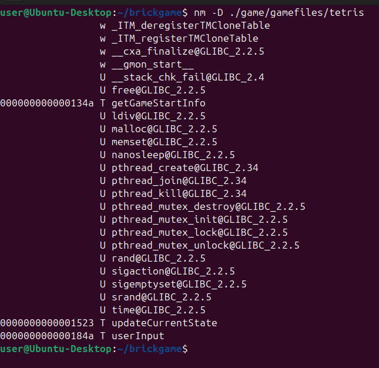

Буквой "Т" обозначены функции которые доступны извне. Но нам достаточно того, чтобы видно было только три (две обязательные и одна необязательная), поентому ко всем остальным функциям мы припишем ключевое слово "static", что сделает их используемыми только внутри файла библиотеки.

### 3.1. Новые концепии

Оговорюсь сразу. Новые для меня.

Вот смотрите, у нас игра раз в какое-то время двигает фигуру вниз по полю. И само собой напрашивается, что нужен таймер.\
Но куда его присобачить, если игра у нас всего лишь отвечает на запросы?

1. Можно в ГУЕ в цикле функции "bool select_and_game()" сделать две переменные - первая будет засечкой времени начальной, в вторая конечной.\
Если разница между ними достигает определенного значения, то в качестве первой пишем вторую, а игре посылаем lib->userInput(какое-то состнояние, false);\
Поскольку второй аргумент мы тут не используем, по вполне прокатит.
2. Каким-то образом делаем то же самое, но из самой игры.

Второй вариант мне видится более правильным, так как гуй должен, по сути, только рисовать.\
Вот только игра сама ничего делает, так как игра - птица гордая. Поентому я полез с инет искать таймеры для С, и ничего дельного не нашел, кроме совета вывести отсечки времени в другой поток. Вот статья: https://habr.com/ru/articles/881444/

Так вот, новой концепцией для себя я называю многопоточность, и связанные с ентим проблемы (вот, к примеру, про мьютексы https://metanit.com/c/tutorial/11.3.php).

Ну, а если мы можем вывести всё в отделный поток, то нам можно использовать привычный sleep.\
Так я набрел на статью на хабре: https://habr.com/ru/articles/569392/

Сразу скажу всем особо ~~отбит~~ дотошным проверяющим: чит - енто когда взял чужой кусок кода не то что не понимая, как он работает, а когда не понимаешь что он тут вообще забыл. Мы пользуемся стандартными библиотеками и не понимаем, как они работают. Нам надо знать какие аргументы мы скармливаем функции, там происходит магия, и обратно возвращается продукт жизнедеятельности функции. Т.е. я могу скомпилить библиотеку, сархивировать в статическую, и через .h файл присоединить к своей. И никакого читерства.

Но, попробуем в ней разобраться, оставить нужное, и выкинуть лишнее, а по пути, желательно, не потерять функционал.

### 3.2. Таймер

Кое что я все же поправил, поентому здесь буду описывать уже результирующее.\
Да, выкинул я немало. К примеру, в нашем случае нам нужен только один таймер, поентому можно было выкинуть счетчик таймеров. Да и мьютекс тут тоже не нужен, потому как не будет конкуренции/гонки данных.

Итак, структура таймера:
```c
typedef struct stimer {
  //Структура времени для nanosleep
  struct timespec sleep_period;
  //То же время, но в удобочитаемых милисекундах
  int s_p;
  //Что-то вроде id потока
  pthread_t tid;
  //Если оно не тру, то таймер будет работать
  bool terminate;
} t_stimer;

typedef struct stimer_events {
  void (*ontime_events)();
} t_stimer_events;
```

Функция создания таймера:
```c
static t_stimer* stimer_create(void) {
  int status = 0;

  t_stimer* new_stimer = malloc(sizeof(t_stimer));
  if (new_stimer == NULL) {
    return NULL;
  }
  //Пока понятно
  new_stimer->terminate = false;
  new_stimer->sleep_period.tv_sec = 1;
  new_stimer->sleep_period.tv_nsec = 0L;
  //Создаем новый поток и определяем функцию, которая в нем должна отработать. 
  //У нас она будет циклом
  status = pthread_create(&new_stimer->tid, 0, execute_thread, new_stimer);

  if (status == 0) {
    stimer_setup_signal_handler();
    return new_stimer;
  } else {
    free(new_stimer);
    return NULL;
  }
}
```

Процесс в потоке:
```c
static void* execute_thread(void* arg) {
  int status;

  t_stimer* timer = (t_stimer*)arg;

  while (timer->terminate == false) {
    //Ждем ответ от nanosleep
    status = nanosleep(&timer->sleep_period, NULL);

    if ((status == 0) && (timer->listener != NULL)) {
      //Если все норм, то дергаем ивентовую функцию ontime_events(), 
      ontime_events();
    }
  }
  return NULL;
}
```

Далее функция рабора ентого дела:
```c
static void stimer_destroy(t_stimer* timer) {
  //Прекращаем выполнять действие в потоке
  timer->terminate = true;
  //Грохаем поток
  pthread_kill(timer->tid,SIGUSR1);
  //Ожидаем ответа о завершении
  pthread_join(timer->tid, NULL);
  //Обнуляем
  free(timer);
  timer = NULL;
}
```

Кстати, убийство потока не проходит даром. Надо отправить специальный сигнал, который дает некоторое объяснение почему поток помер, а мы не хотим, чтобы нам посередь экрана вылезло какое-нибудь сообщение.

!!!Примечание!!! По идее мы можем и не трогать поток, после разбора таймера он сам должен прекратиться, но енто будет с некоторым лагом (sleep period), а так мы просто ускоряем процесс. Но вводим парочку функций.

Первая из них - переопределение пользовательского сигнала:
```c
//Просто пустая функция, которая ничего не делает
static void stimer_sig_handler(int signo) { (void)signo; }
```

Вторая же устанавливает нашу переопределенную функцию в качестве сигнала:
```c
static void stimer_setup_signal_handler(void) {
  struct sigaction sa;
  memset(&sa, 0, sizeof(sa));
  sa.sa_handler = stimer_sig_handler;
  sigemptyset(&sa.sa_mask);
  sigaction(SIGUSR1, &sa, NULL);
}
```

Ну и собственно основные пользователькие функции... ээээ... функция - установка sleep period:
```c
static void stimer_set_interval(t_stimer* timer, int value) {
  ldiv_t t = ldiv(value, 1000);
  timer->sleep_period.tv_sec = t.quot;
  timer->sleep_period.tv_nsec = t.rem * 1000000;
  //Данное значение ввел просто для удобства
  timer->s_p = value;
}
```

### 3.3. Концепт логики игры. 

Слегка передохнём от кода и подумаем, как нам организовать саму игру.\
Тут тоже есть много различных вариантов решения. Я же, как обычно для меня, буду искать самый простой путь.

Сначала составим блок-схему. Причем, от нас ентого просят и в самом задании. Хотя в ентом же самом задании нас приведят пример:

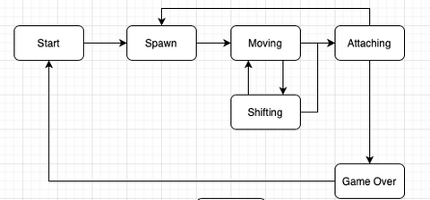

Да и, в сущности, чего тут менять, решительно не понимаю. Тут и так все ок. Разве что можно дополнить диаграмму проверками и присоединить к гуевой схеме.

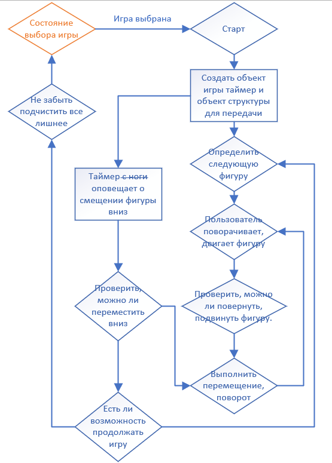

Как видно, изменения не драматические.

Приступим к некоторым определениям. Так как есть некоторые непонятки в ТЗ, которые отданы на наше усмотрение. К примеру, фигуры.\
Под них можно выделить массив 2х3 и для палки 1х4, можно просто выделить 2х4, а при повороте учитывать верхний левый гугол.

Но, мне влом. А по сему, под фигуры мы возьмем квадрат 4х4. Как Нива.\
И тогда таблица фигур и поворота фигур будет тоже проста, как Нива.

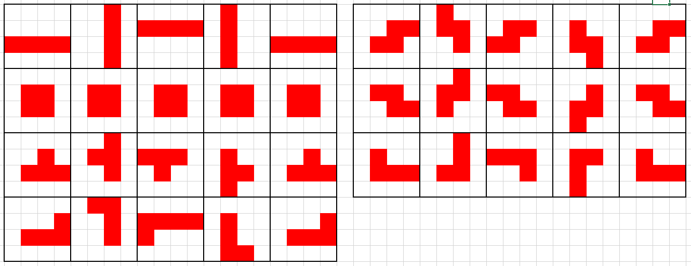

Не отходя далеко можно даже набросать функцию исполнения поворота:
```c
static void rotate_figure(void) {
  GameObject_t *game_object = game_obj();
  int temp[4][4];
  //Вот тут происходит что-то вроде обратного транспонирования матрицы
  //Такого же эффекта можно добиться в 2 действия: отзеркалить матрицу и транспонировать
  for (int i = 0; i < 4; i++) {
    for (int j1 = 0, j2 = 3; j1 < 4; j1++, j2--) {
      temp[j2][i] = game_object->current_figure[i][j1];
    }
  }
  if (check_rotate(temp)) {
    for (int y = 0; y < 4; y++) {
      for (int x = 0; x < 4; x++) {
        game_object->current_figure[y][x] = temp[y][x];
      }
    }
  }
}
```

Далее. Весьма важный вопрос про проверки выхода за пределы поля, и столкновения фигур.\
Тут тоже можно сделать по умному, все расчитать, привести умные формулы.

Не наш метод))

Самое простое - реализовать что-то вроде растровой графики с маской. Енто удобно, так как растр уже с обозначенной нулями маской, как и само поле.

И функции проверки на возможность перемещения выглядят следующей образой.\
Проверка пемерещения влево:
```c
static bool check_left(void) {
  GameObject_t *game_object = game_obj();
  bool res = false;
  for (int x = 0; x < 4 && !res; x++) {
    for (int y = 0; y < 4 && !res; y++) {
      if ((game_object->current_figure[y][x] != 0) &&
          (game_object->current_field[game_object->current_figure_y + y]
                            [game_object->current_figure_x + x - 1] !=0)) {
        res = true;
      }
    }
  }
  return res;
}
```
Всё довольно просто. Сам спрайт с фигурой - отдельный объект от игрового поля, до тех пока, пока есть куда двигаться.\
Отдельными переменными нам изветсно его местоположение относительно игрового поля current_figure_y, current_figure_x.\
И про движении влево мы просто перебираем от х1 до х4, от строки у1 до у4 для каждой колонки, и, если у фигуры на ентой клетке на нуль, проверяем, есть ли в клетке на основном поле на колонку левее что-нибудь. Первое же совпадение скажет нам о том, что не подвинуть фигуру.

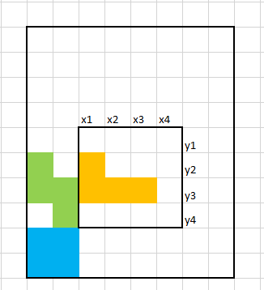

Проверка перемещения направо такая же, только мы проверяем от х4 до х1 и клетку с правой (х+1) стороны.

Проверка вниз - та же фигня, только идем не по колонкам, а по строкам от у4 до у1, и уже дл каждой строки от х1 до х4, ну и проверяем клетку ниже (у+1).

Если вы думаете, то тут легко получить наш любимый segmentation fault, то вы абсолютно правы.\
Но и на енто у меня есть абсолютно простейшее решение - мы сделаем как на съемочной площадке. Т.е. у нас будет кадр объектива, но само пространство будет больше. Размер игрового поля мы увеличим по бокам и низу на 1. А чтобы можно было легко оперировать фигурами еще не появившимися на поле, то сверху мы добавим еще 4 строчки. Но ГУЮ будет отправлять только то, что ему надо видеть:

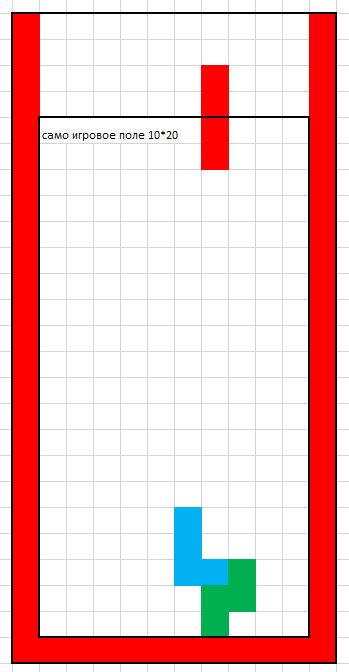

Вот как-то так.

Ну а как отдать енто все гую на отрисовку:
```c
GameInfo_t updateCurrentState(void) {
  GameObject_t *game_object = game_obj();
  if (game_object->inited) {
    //Создадим временный массив и нарисуем в него все наше поле
    int temp[25][12];
    for (int i = 0; i < 25; i++) {
      for (int j = 0; j < 12; j++) {
        temp[i][j] = game_object->current_field[i][j];
      }
    }
    //Нанесем на него по текущему положению текущую фигуру
    for (int i = 0; i < 4; i++) {
      for (int j = 0; j < 4; j++) {
        if (game_object->current_figure[i][j])
          temp[i + game_object->current_figure_y][j + game_object->current_figure_x] =
                  game_object->current_figure[i][j];
      }
    }
    //А потом в передаваемый объект внесем только то, что надо.
    for (int i = 0; i < 20; i++) {
      for (int j = 0; j < 10; j++) {
        game_object->GameInfo.field[i][j] = temp[i + 4][j + 1];
      }
    }
  }
  return game_object->GameInfo;
}
```

Ну и всё. Теперь осталость лишь прописать пару дополнительных функций, и готово.

### 3.4. Функциональная часть игры

Начать хотелось бы с одной неочевидной вещи. У нас по абсолютно дурацкому стечению объстоятельств може одномоментно произойти следующая ситуевина:
1. Программа готовит гую объект для передачи.
2. Пользователь двигает или поворачивает фигуру
3. Таймер говорит, что пора сдвинуть вниз.

Какой шанс словить артефакты при отрисовке, или вообще на игровом поле?\
Вот тут то нам и понадобится мьютекс. При любом действии, которое не читает состояние, а изменяет его, мы блочим процесс.\
И, к примеру, описанная выше функция передачи для отрисовке будет выглядет так:
```c
GameInfo_t updateCurrentState(void) {
  GameObject_t *game_object = game_obj();
  //Блочим поток
  pthread_mutex_lock(&(game_object->state_lock));

  if (game_object->inited) {
    int temp[25][12];
    for (int i = 0; i < 25; i++) {
      for (int j = 0; j < 12; j++) {
        temp[i][j] = game_object->current_field[i][j];
      }
    }
    for (int i = 0; i < 4; i++) {
      for (int j = 0; j < 4; j++) {
        if (game_object->current_figure[i][j])
          temp[i + game_object->current_figure_y]
              [j + game_object->current_figure_x] =
                  game_object->current_figure[i][j];
      }
    }
    for (int i = 0; i < 20; i++) {
      for (int j = 0; j < 10; j++) {
        game_object->GameInfo.field[i][j] = temp[i + 4][j + 1];
      }
    }
  }
  //Далем копию состояния, и разблокируем поток для других изменений
  GameInfo_t result = game_object->GameInfo;
  pthread_mutex_unlock(&(game_object->state_lock));
  //Передаем копию
  return result;
}
```

Функию "void userInput(UserAction_t action, bool hold)" нет смысла разбирать, она принимает указание действия, блокирует поток, делает штуку и разблокирует поток.

А вот со структурой игры стоит ознакомиться:
```c
typedef struct GameObject_t {
  //Оно здесь потому, что там динамические массивы и их надо инициировать/высвободить
  GameInfo_t GameInfo;
  //Указание на то, что мы работаем
  bool inited;
  //Енто для паузы и еще пары функций. Не принимает действи от пользователя
  bool blocked;
  //Собстна поле и текущая фигура
  int current_field[25][12];
  int current_figure[4][4];
  //Указатель на верхний левый гугол фигуры
  int current_figure_x;
  int current_figure_y;
  //Об ентом чуть позже
  int ramming_stage;
  //Таймер
  t_stimer* timer;
  //Мьютекс
  pthread_mutex_t state_lock;
} GameObject_t;
```

Создание объетка:
```c
static bool init_gameinfo(void) {
  GameObject_t *game_object = game_obj();
  int status = 0;
  game_object->GameInfo.field = (int **)malloc(20 * sizeof(int *));
  if (!game_object->GameInfo.field) status = 1;

  if (status == 0) {
    for (int y = 0; y < 20; y++) game_object->GameInfo.field[y] = NULL;
    game_object->GameInfo.next = (int **)malloc(4 * sizeof(int *));
    if (!game_object->GameInfo.next) status = 2;
  }

  if (status == 0) {
    for (int y = 0; y < 4; y++) game_object->GameInfo.next[y] = NULL;
    game_object->timer = stimer_create();
    if (game_object->timer == NULL) status = 3;
  }

  if (status == 0) {
    if (pthread_mutex_init(&(game_object->state_lock), NULL) != 0) status = 4;
  }

  if (status == 0) {
    for (int y = 0; y < 20 && (status == 0); y++) {
      game_object->GameInfo.field[y] = (int *)malloc(10 * sizeof(int));
      if (!game_object->GameInfo.field[y]) {
        for (int y1 = 0; y1 < y; y1++) {
          free(game_object->GameInfo.field[y1]);
        }
        status = 5;
      }
    }
    for (int y = 0; y < 4 && (status == 0); y++) {
      game_object->GameInfo.next[y] = (int *)malloc(4 * sizeof(int));
      if (!game_object->GameInfo.next[y]) {
        for (int y1 = 0; y1 < y; y1++) {
          free(game_object->GameInfo.next[y1]);
        }
        status = 6;
      }
    }
  }
  if (status == 0) {
    //Если каким-то чудом памяти на все хватило, то надо выставить дефолтные значения
    fill_defaults();
  }
  //А если нет, то все аккуратно освободить
  if (status != 0) free_gameobject(status);
  return status == 0 ? true : false;
}
```

Заполнение и освобождение такие же скучные. Поговорим немного о выборе новой фигуры.\
Для фигур я сделал небольшой define:
```c
#define FIGURES_LIST                                                \
  {                                                                 \
    {{0, 0, 0, 0}, {0, 0, 0, 0}, {1, 1, 1, 1}, {0, 0, 0, 0}},       \
        {{0, 0, 0, 0}, {0, 6, 0, 0}, {0, 6, 6, 6}, {0, 0, 0, 0}},   \
        {{0, 0, 0, 0}, {0, 0, 0, 3}, {0, 3, 3, 3}, {0, 0, 0, 0}},   \
        {{0, 0, 0, 0}, {0, 7, 7, 0}, {0, 7, 7, 0}, {0, 0, 0, 0}},   \
        {{0, 0, 0, 0}, {0, 0, 2, 2}, {0, 2, 2, 0}, {0, 0, 0, 0}},   \
        {{0, 0, 0, 0}, {0, 5, 5, 0}, {0, 0, 5, 5}, {0, 0, 0, 0}}, { \
      {0, 0, 0, 0}, {0, 0, 4, 0}, {0, 4, 4, 4}, { 0, 0, 0, 0 }      \
    }                                                               \
  }
```

Т.е. то, что не нули, то - сама фигура.
```c
static void make_rand_next(void) {
  GameObject_t *game_object = game_obj();
  //Из ентого определения собираем массив фигур
  int standard_figures[FIGURE_COUNT][4][4] = FIGURES_LIST;
  //И копируем в next ту, на какую "жребий" укажет
  int r = rand() % FIGURE_COUNT;
  for (int y = 0; y < 4; y++) {
    for (int x = 0; x < 4; x++) {
      game_object->GameInfo.next[y][x] = standard_figures[r][y][x];
    }
  }
}
```

Все остальные функции весьма интуитивны, кроме одного момента - сборки линий.\
Вот тут мне не захотелось делать совсем по-простому. Ведь енто можно было сделать в одно действие:
1. Найти заполненные линии
2. Насчитать очки
3. Занулить линии
4. Циклом сдвинуть построчно сниз, пока сдвигается.

Но мне захотелось внести чутка... ну... назвем енто визуальными эффектами.\
Действия будут те же, но разнесены во времени. Тут пришла пора объяснить за переменную ramming_stage:
```c
//Если ramming_stage = 0, то значит что никаких анимаций не выполняется
//Но надо проверить, не собрал ли игрок линию
static void ramming_field_0(void) {
  GameObject_t *game_object = game_obj();
  int full_rows = 0;
  for (int y = 4; y < 24; y++) {
    bool check = true;
    for (int x = 1; x < 12 && check; x++) {
      if (game_object->current_field[y][x] == 0) check = false;
    }
    if (check) full_rows++;
  }
  //Если собрал, то, в зависимости от количества собранных начисляем очочков
  if (full_rows > 0) {
    switch (full_rows) {
      case 1:
        game_object->GameInfo.score += 100;
        break;
      case 2:
        game_object->GameInfo.score += 300;
        break;
      case 3:
        game_object->GameInfo.score += 700;
        break;
      case 4:
        game_object->GameInfo.score += 1500;
        break;
    }
    //Пересчитываем ramming_stage, уровень, скорость и рекорд
    game_object->ramming_stage = 21 + full_rows;
    game_object->GameInfo.level = ((game_object->GameInfo.score / 600) % 10) + 1;
    game_object->GameInfo.speed = ((game_object->GameInfo.score / 600) % 10) + 1;
    if (game_object->GameInfo.high_score < game_object->GameInfo.score)
      game_object->GameInfo.high_score = game_object->GameInfo.score;
    //Отрубаем пользователю управление
    game_object->blocked = true;
    //И замедляем таймер
    stimer_set_interval(game_object->timer, 1000);
  }
}
```

На следующий тик таймера, если ramming_stage > 20:
```c
static void ramming_field_20(void) {
  GameObject_t *game_object = game_obj();
  for (int y = 4; y < 24; y++) {
    bool check = true;
    for (int x = 1; x < 12 && check; x++) {
      if (game_object->current_field[y][x] == 0) check = false;
    }
    if (check) {
      for (int x = 1; x < 12 && check; x++) {
        //Перекрашиваем собранные строки (такой образой мы их выделяем)
        game_object->current_field[y][x] = 7;
      }
    }
  }
  //Уменьшаем ramming_stage на 10
  game_object->ramming_stage = game_object->ramming_stage - 10;
}
```
На следующий тик таймера, если ramming_stage > 10 перекрасим их еще раз только в нули, а вот если у нас ramming_stage < 10, то:
```c
static void ramming_field_1(void) {
  GameObject_t *game_object = game_obj();
  //Сдвигаем первую попавшуюся снизу
  bool iter = true;
  for (int y = 23; y > 3 && iter; y--) {
    bool check = true;
    for (int x = 1; x < 12 && check; x++) {
      if (game_object->current_field[y][x] != 8) check = false;
    }
    if (check) {
      for (int y1 = y; y1 > 4; y1--) {
        for (int x = 1; x < 12; x++) {
          game_object->current_field[y1][x] =
              game_object->current_field[y1 - 1][x];
        }
      }
      for (int x = 1; x < 12; x++) {
        game_object->current_field[4][x] = 0;
      }
      iter = false;
    }
  }
  //И уменьшаем ramming_stage на один. Так мы обеспечим плавную анимацию
  game_object->ramming_stage = game_object->ramming_stage - 1;
  if (game_object->ramming_stage == 0) {
    //Ну а если сдвигать болльше нечего, то восстанавливаем скорость
    stimer_set_interval(game_object->timer, SPEED(game_object->GameInfo.speed));
    //И снова начинаем принимать от игрока сигналы
    game_object->blocked = false;
  }
}
```